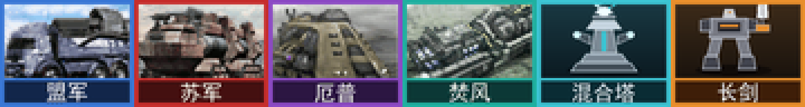

# Mental Omega — Noob Edition

A single-player quality-of-life patch for **Mental Omega 3.3.6** (a fan-made
expansion for *Command & Conquer: Red Alert 2 — Yuri's Revenge*).

It unlocks the co-op missions for offline play, adds six always-available
support powers, and lets you deploy a tech MCV that opens any faction's full
tech tree — while leaving ordinary skirmish and campaign play **provably
untouched**.

**中文说明见 [README.zh-CN.md](README.zh-CN.md)。**



---

## ⚠️ This build cannot be used online

**This is a single-player patch and cannot be used for multiplayer.** Do not
host it, do not join CnCNet or LAN games with it, do not play it against other
people.

It changes `rulesmo.ini`, which means your game no longer matches anyone
else's: against a player without the identical patch the match desyncs and
drops, ruining the game for everyone in it. And even if you did get a game
going, using it in online PvP is **flat-out cheating** — always-on support
powers, every faction's tech tree, one building that counts as every tech
building on the map.

It exists for two kinds of players:

- people who keep getting stuck on a campaign mission and just want to see the
  rest of the story;
- people who have nobody to play the co-op missions with, and until now could
  not play them at all.

If you have friends to play with, play the real thing. It is better.

---

## What it changes

### 1. Co-op missions, playable offline

All 36 co-op maps now appear under **Skirmish → Game Mode → Co-Op
(Casual / Normal / Brutal)**. No CnCNet, no lobby, no second human.

Mental Omega locks them in three separate places; all three are cleared:

| Where | Flag |
|---|---|
| `MentalOmegaMaps.ini`, the three Co-Op mode sections | `HumanPlayersOnly`, `MultiplayerOnly` |
| `MentalOmegaMaps.ini`, each of the 36 per-map entries | `MultiplayerOnly` |
| The 36 `.map` files, `[Basic]` | `MultiplayerOnly` |

**Slot 2's half of the mission is handed to slot 1.** Several co-op missions
need both players doing something deliberate at the same time, which an AI
ally cannot manage. Every co-op map scripts two player slots through the map
format's `4475` / `4476` house codes; the patch rewrites `4476` to `4475`
across all trigger events and actions **and** rewrites `House=<Player @ B>`
to `<Player @ A>` on every TeamType, so slot 2's starting units, its
reinforcements and its objective triggers all belong to you. 36 maps,
105 events, 149 actions and 435 team assignments.

Both encodings matter. Slot 2 is the numeric `4476` inside trigger data and
the string `<Player @ B>` on team and script houses. Rewriting only the
numbers left reinforcement teams such as *Reznov Arrives* bound to a slot
that no longer exists, so the hero never spawned and the map's
"[Lose] Reznov Dies" trigger — an event 61 test for the `REZNOV` type
existing — fired on the first frame. Slots `C`, `D` and `E` are the scripted
enemies and are left alone.

**Play them alone — do not add an AI ally.** Once slot 2 owns nothing the
engine declares that house defeated on the first frame, and a defeated ally
fails the mission. `MinPlayers` alone is not enough -- the client fills a co-op lobby up to
`MaxPlayers` and refuses to start with an empty slot -- so the patch sets both
`MinPlayers` and `MaxPlayers` to 1 in the client's map entries, plus
`MinPlayer` in each map's `[Basic]`. The ally slot stops existing. The
scripted enemies are unaffected: the client builds them from each entry's own
`EnemyHouse0` / `EnemyHouse1`, which have nothing to do with the player slots.

None of the 36 maps ever fails the player by trigger — every win/lose action
targets the enemy slots `4477` / `4478`. The instant failure came purely from
the engine's own "house with nothing left is defeated" rule. That is
deliberate: several missions' win/lose triggers reference the second house, and
the client builds the scripted enemy AI from each map's own `EnemyHouse0/1`
entries, so the mission plays out properly.

> These missions cannot be moved onto the Campaign screen. Co-op maps have no
> `[Houses]` section at all — every house is created from the lobby's
> `spawn.ini`. The Campaign screen uses the single-house launch path, so the
> houses would simply never exist and the trigger chain would break. Skirmish
> uses the same multiplayer house logic the lobby does, which is why it works.

### 2. Six support powers, always available

Built on Ares' `SW.AlwaysGranted`, so they need no building, survive a power
outage, and stay available even with *Superweapons: Off*.

| Power | Delivers |
|---|---|
| 传送：长剑毁灭装甲 | Shin Tsurugi Decimator |
| 传送：混合塔 | Hybrid Tower |
| 传送：盟军科技基地车 | Allied Tech MCV |
| 传送：苏军科技基地车 | Soviet Tech MCV |
| 传送：厄普西隆科技基地车 | Epsilon Tech MCV |
| 传送：焚风科技基地车 | Foehn Tech MCV |

`SW.AllowAI=no` — the AI never gets any of them.

### 3. Hybrid Tower tuning

| Key | Stock | Noob |
|---|---|---|
| `Power` / `Powered` | -150 / yes | **0 / no** (no drain, works unpowered) |
| `Sight` | 8 | **16** |
| Weapon range | 14 / 15 | **21 / 22.5** (stock +50%) |
| `Strength` | 1050 | **3333** |
| `SelfHealing` | — | **yes** |
| Anti-air | none | **yes** |

Anti-air is done with a new projectile, `InvisibleHighAA` — a copy of
`InvisibleHigh` with `AA=yes`. The stock projectile is shared by 90 weapons and
is never touched; `HybridBolt`/`E`/`Support` are used by the Hybrid Tower and
nothing else in the entire mod, so the swap has no side effects.

### 4. Four tech MCVs

A support power delivers a tech MCV; deploy it and that faction's **entire**
tech tree becomes buildable — you construct and pay for everything normally,
nothing is gifted.

Mental Omega gates construction with four independent tags, all verified
against `Ares.dll`:

```
buildable countries = Owner ∩ RequiredHouses ∩ FactoryOwners − ForbiddenHouses
```

Every registered type is classified by that formula:

| Group | Count | Treatment | Effect on normal play |
|---|---:|---|---|
| Effective owners already cover a whole faction | 188 | open to all 12 countries | **none** |
| Sub-faction exclusive | 94 | **cloned** into new `SU*` entries; the originals are not touched | **none** |
| Stolen-tech units behind the beacon | 10 (+2 partners) | cloned; gated on the beacon | **none** |
| Hero infantry | 21 + Boris | cloned; gated on the beacon | **none** |
| Allied Battle Lab | 1 | cloned; gated on the Allied tech yard | **none** |
| Props, spawned objects, projectiles | rest | untouched | — |

The clones require the tech Construction Yard, so a normal player — who only
ever has their own stock yard — can never see them. Euro Alliance's Cavalier
stays Euro Alliance's.

### 5. Far Star Support Beacon

A new building any tech Construction Yard can put up. It is a rebuild of Mental
Omega's *Blackout Research Station* prop — the donor art has no `Buildup=`, so
it appears without a construction animation. Cosmetic only. The prop has no
sidebar icon; the beacon gets one of its own.

It does four things.

**Doubles as seven tech buildings** — owning it is as good as holding all of:

| Tech building | Effect |
|---|---|
| Tech Infantry Academy | new infantry come out veteran |
| Tech Heavy Machinery Plant | new land vehicles come out veteran |
| Tech Military Docks | new ships come out veteran |
| Tech Aeronautics Academy | new aircraft come out veteran |
| Tech Defense Bureau | new defenses come out veteran |
| Tech Machine Shop | all vehicles slowly self-repair |
| Tech Hospital | all infantry slowly self-heal |

The effects are plain building tags (`Academy.*Veterancy`,
`UnitsGainSelfHeal`, `InfantryGainSelfHeal`). The patcher **reads them out of
the seven stock buildings** at build time and merges them onto the beacon —
nothing copied by hand, and the stock buildings stay untouched.

**Doubles as a Grinder** — send any unit of yours into it and it is recycled
for half its cost, exactly like Epsilon's Grinder (`Grinding=yes` and the
enter cursor are read from the stock `YAGRND`). There is no grinding
animation; the unit simply goes in and turns into money.

**Carries the Far Star Knights Aid support power** — built from MO's own
`PaladinAidSpecial`, so it behaves like a stock power:

| | |
|---|---|
| Delivers | 2x Prism Tank, 2x Abrams, 2x Blizzard, 2x Paladin Hunter, 1x Repair Drone |
| Cost | 8500 |
| Recharge | 15 seconds |
| Power | goes offline with the grid |

**Unlocks ten stolen-tech units at any faction's war factory**: Quickshifter,
Future Tank Alpha, Grumble AA, Apocalypse, Iron Dragon, Scavenger, Worm Queen,
Phantom MLRS, Seitaad Ballista, Ram.

Those ten are normally locked behind a spy infiltration, and the gate does not
live in `rulesmo.ini` at all — it is in `INI/Game Options/Stolen Tech.ini`,
which the client merges into the map at launch and which therefore *overrides*
the rules. Editing that file would hand every player the ten units without a
spy, so the patch clones them instead: `SU*` copies whose prerequisite is
`FACTORY` plus the beacon. The stock ten are left byte for byte alone and
`Stolen Tech.ini` is never touched, which keeps the regression proof valid.

The two units that transform (Future Tank Alpha, Grumble) get their partners
cloned too, so a deployed clone never hands back a stock unit the player has no
tech for.

### 6. Allied Battle Lab, mission-proof

Some maps lock the Allied high-tech branch with their own INI overrides, and
those overrides name the stock `GATECH`. The patch adds `SUGATECH`, a copy
whose only prerequisite is the Allied tech Construction Yard — nothing a map
can reach. It also joins `[General] PrerequisiteTech`, so anything that asks
for a generic tech building accepts it.

### 7. Hero infantry

**21** hero infantry — Tanya, Siegfried, Volkov, Morales, Yunru, Rahn,
Libra, Eureka, Yuri, Reznov, Krukov, Rhad, Boris and the rest — become
buildable at **any faction's barracks** once the Far Star Support Beacon
stands.

They are identified from Mental Omega's own `[ArmorTypes]` *Heroes Infantry
Group* block rather than by name, so the list cannot drift if MO renames
anything. Skipped: `AIMORA`, the AI-only duplicate of Morales, the three
easter-egg action-movie commandos (`ARND` / `STLN` / `CLNT`) and Libra's
clone (`LIBRC`).

- **Boris** is not in Mental Omega's rules at all — MO defines him per map
  (the Soviet 1 map only sets his TechLevel). The patcher reads MO's own full
  definition out of the *Revolution* challenge map (`c_revolution.map`) in
  your installation; art, cameo, AK weapons and voices are all stock. One
  change: that map arms him with the AI's airstrike flare, which is swapped
  for the player version (the one with attack cursors).
- **Build time**: MO gives its campaign-only heroes — Reznov, Krukov, Rhad,
  the Space Commando, Yuri X — a 121x build time, a de facto lock. The clones
  get the ordinary heroes' 2x.
- **Yuri** gets a sidebar icon: stock `YURIX` art has none, so the clone gets
  its own art entry and the unused Yuri portrait from MO's mixes, relabelled.
- Every hero clone self-heals.

As everywhere else, these are `SU*` clones; the stock heroes are untouched.

### 8. Two campaign missions eased

- **Soviet finale, *Death's Hand*** — the boss's two weapons (`DeathBolt` /
  `DeathBoltAA`) do 1 damage and fire 10x slower. No unit in the rules uses
  them; only that mission's map arms the boss with them, so nothing else moves.
- **Fatal Impact** — the main mission timer goes from 160 minutes to **4
  hours**, and Volkov fits into transports before his transformation. A loose
  `sfatal.map` is written into the game folder (the engine reads loose files
  before the mixes); exactly four lines differ from MO's.

### 9. Player buildings repair themselves

The AI's buildings start repairing the moment they are damaged; the player has
to click the wrench on each one. `MOAutoRepair.dll` is a small Syringe plugin
(source in `tools/autorepair/`, no C runtime, no imports, 4.6 KB) that does the
clicking for you: every 30 frames it finds your damaged buildings that the
engine would let you repair and sends the very same repair event the wrench
sends. Repairs cost money as usual. Its one hook overlaps none of Ares'.

### 10. Optional extras, from other mods you already have

These are built only if you point the patcher at your own copy of the mod they
come from (see *Install*). Nothing from them is in this repository.

- **Phobos UI** (from *企鹅的心灵终结 v1.1*, `--qier`): superweapon sidebar
  (3 columns), harvester counter, power delta, a centred message board with
  history, extended tooltips, power-plant enhancer range. Phobos needs its own
  Syringe fork, so `Syringe.exe` becomes SyringeEx 0.7.2.0 and the client's
  launch line in `Resources/ClientDefinitions.ini` changes to SyringeEx's
  syntax (keeping MO's `-SPEEDCONTROL` and `-AFFINITY`). Restart the client
  fully afterwards. Shows Phobos' own "pre-release build" watermark.
- **12 skirmish maps** (same pack, `--qier`): three reworked classics and nine
  "special event" maps. They use Mental Omega's own units only. The pack's
  reworked *East Wind Valley* is left out on purpose: it pulls in the pack's
  whole rebalance.
- **Touhou infantry** (from *东方秽浪港 ~ Ambitions Behind Corpse.*, `--abc`):
  ten character infantry plus that mod's Prism Tank, buildable at any barracks
  / war factory with the Far Star Support Beacon, renamed into their own
  `ABC_*` namespace with their assets in `expandmo93.mix`.

---

## Install

You need your own legal copy of **Mental Omega 3.3.6**. This repository ships
**no** Mental Omega content — the patcher reads the pristine data out of your
installation's own mix files and writes the patched result back.

Requires Python 3.8+ and `pip install pillow pefile` (the Yuri icon is drawn at
build time; `pefile` checks the plugin). `pip install ziglang` only if you want
the auto-repair plugin rebuilt from source — a built copy is included.

```bash
git clone https://github.com/starunity1789-bot/mental-omega-noob-edition.git
cd mental-omega-noob-edition
python tools/build_mod.py --game "D:/Games/Mental Omega"
```

The first run snapshots every game file it is about to replace into
`work/original/` and records every file it adds, then remembers the paths in
`local.json`, so later commands need no `--game`.

```bash
# build without touching the game, for inspection
python tools/build_mod.py --dry

# prove the patch changes nothing for a normal player
python tools/validate.py

# undo everything, byte for byte
python tools/build_mod.py --restore

# the optional extras: snapshot once, rebuilt on every later run
python tools/build_mod.py --qier "D:/Mods/企鹅的心灵终结v1.1" --abc "D:/Games/东方秽浪港/Game"
```

Leaving an optional part out later (deleting its snapshot under `work/`) puts
the files it had replaced back the way they were on the next run.

Tool output is in Chinese, since that is who this is for.

---

## How "no effect on normal play" is verified

`tools/validate.py` runs three passes:

- **Structural** — every registered type is unique, every referenced ID
  resolves, every clone's convert/deploy links point at clones rather than
  stock partners, every cameo is a valid 60×48 8-bit PCX.
- **Regression** — for each of the 12 countries, it computes the complete set
  of everything that country can build, before and after the patch, and
  requires the two sets to be **identical item for item**. This is the machine
  proof that ordinary skirmish and campaign play are unchanged.
- **Unlock coverage** — with a foreign tech Construction Yard, **100 %** of
  that faction's exclusive buildable content becomes reachable.
- **Beacon gate** — the ten stolen-tech clones are unbuildable without the
  beacon standing and all ten are buildable with it, and the ten stock entries
  are compared key by key against pristine to prove they never moved.
- **Hero gate** — same proof for the 21 hero clones, plus a key-by-key check
  that no stock hero's stats, weapons or art changed; the easter-egg units
  are not cloned; every clone self-heals and builds in at most 2x time; Boris
  matches the map's definition key by key.
- **Beacon as tech buildings** — the beacon's six effect tags match the seven
  stock tech buildings exactly, and those buildings are untouched.
- **Battle Lab gate** — `SUGATECH` needs the Allied tech yard and nothing else.
- **Co-op ownership** — no reference to slot 2 survives in any co-op map's
  events or actions, and every map plus every client entry accepts one player.
- **The rest** — the Grinder keys match `YAGRND`; Death's Hand changed only
  its two weapons' two keys; *Fatal Impact* differs from MO's map in exactly
  four lines; the auto-repair hook overlaps no Ares hook; and, when built,
  every optional part (Phobos hooks vs Ares and the plugin, map entries,
  Touhou assets findable in the mix) is checked too.

It was also checked in game against Ares' own parser log, same map and seed,
stock rules versus patched:

| Ares log | Stock | Noob |
|---|---:|---:|
| `Failed to parse` | 0 | 0 |
| `Abandoning production of` | 0 | 0 |
| `[Developer error]` | 1 | 1 |
| `[Developer warning]` | 1 | 1 |
| `[Developer fatal]` | 586 | 586 |
| `[Developer notice]` | 30 | 30 |

(The one warning and the notices are Mental Omega's own — stock MO already
ships 1156 `BuildingTypes`, over the 512 Ares warns about.)

---

## Copyright

**Command & Conquer: Red Alert 2 — Yuri's Revenge is © Electronic Arts.**

**Mental Omega is the work of Speeder and the Mentalmeisters**, powered by Ares
(AlexB) and the CnCNet team. All Mental Omega assets, rules, maps, artwork,
text and balance design belong to them.

This repository claims none of it. It contains only patch scripts, eight
cameo icons drawn for the new support powers and the beacon, the auto-repair
plugin (source and a build of it), and documentation. Every byte of game
content is read from, and written back to, your own installation. The same
goes for the optional extras: Phobos and SyringeEx, the QiEr pack's maps and
the Touhou units are read from your own copies of those mods and belong to
their authors.

Mental Omega's own readme asks that it not be re-uploaded without permission,
which is exactly why this is a patcher and not a repack. **Get the game from
[mentalomega.com](https://mentalomega.com) only.**

This project is unofficial, is not endorsed by Electronic Arts or by the
Mental Omega team, and is not supported by either. If the Mental Omega team
would like it taken down, it will be.

## Acknowledgements

- Speeder and the Mentalmeisters — Mental Omega
- AlexB — Ares
- The CnCNet team — client and multiplayer infrastructure
- The Phobos team — Phobos and SyringeEx (optional UI features, GPL-3.0)
- The authors of *企鹅的心灵终结 v1.1* — the Phobos setup and the 12 maps
- The authors of *东方秽浪港 ~ Ambitions Behind Corpse.* — the Touhou units
