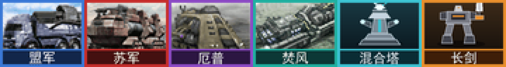

# 心灵终结 · Noob 版（菜鸟版）

给 **心灵终结 3.3.6**（Mental Omega，《红色警戒2 尤里的复仇》同人资料片）做的
单机向补丁。

解锁合作任务的离线游玩、增加六个常驻支援技能、加入可展开出任意阵营完整科技树的
科技基地车 —— 同时**用机器证明**普通遭遇战和战役毫发无损。



---

## ⚠️ 本版本不能用于联机

**这是纯单机补丁，不能用于联机。** 不要开房，不要进 CnCNet 或局域网对战，不要拿它和别人打。

它改了 `rulesmo.ini`，你的游戏规则已经和别人不一样：和没打同一补丁的人对战会直接失步
（desync）掉线，毁掉整局所有人的游戏体验。就算想办法连上了，用它打联机 PVP 也是
**严重的作弊行为** —— 常驻支援技能、任意阵营科技树、信标兼任全部科技建筑，
这些在对战里都是碾压级的优势。

它是给两种人做的：

- 战役卡关反复过不去，只想看完剧情的；
- 没有朋友一起打合作任务，以前压根玩不了那 36 张图的。

**有朋友的话，去打原版。原版更好。**

---

## 改了什么

### 一、合作任务可以离线打了

36 张合作地图现在出现在 **遭遇战 → 游戏模式 → 合作任务-休闲 / 普通 / 终结**。
不用联网，不用开房间，不用第二个真人。

心灵终结在**三个地方**锁了它，三处全部解除：

| 位置 | 标记 |
|---|---|
| `MentalOmegaMaps.ini` 的三个 Co-Op 模式段 | `HumanPlayersOnly`、`MultiplayerOnly` |
| `MentalOmegaMaps.ini` 里 36 张地图各自的条目 | `MultiplayerOnly` |
| 36 个 `.map` 文件的 `[Basic]` | `MultiplayerOnly` |

**2 号位那一半任务已经划归 1 号位。** 部分合作关卡要求两名玩家同时做有意识的操作，
AI 盟友搞不来。每张合作地图都用地图格式的 `4475` / `4476` 所属方代码来脚本化两个位置；
本补丁把触发器事件和动作里的 `4476` 全部改写为 `4475`，**并且**把所有作战小队的
`House=<Player @ B>` 改写为 `<Player @ A>`，于是 2 号位的初始单位、增援和任务触发
**全部归你**。36 张图，事件 105 条 + 动作 149 条 + 小队归属 435 条。

**两套编码都得改。** 2 号位在触发数据里是数字 `4476`，在小队/脚本的所属方里是字符串
`<Player @ B>`。只改数字的话，像「雷泽诺夫抵达」这样的增援小队仍然挂在一个已经不存在
的位置上 —— 英雄根本不生成，地图那条「雷泽诺夫阵亡即失败」（事件 61：检测 `REZNOV`
这个类型是否存在）当场就触发。`C` / `D` / `E` 是脚本化的敌方，一律不动。

**一个人打，不要放 AI 盟友。** 2 号位一旦一无所有，引擎会在第一帧就判这个阵营出局，
而盟友出局会直接导致任务失败。光降 `MinPlayers` 不够 —— 客户端会把合作任务大厅自动填满到 `MaxPlayers`，
而且空着位置不让开始。所以本补丁把客户端条目的 `MinPlayers` 和 `MaxPlayers`
**都设成 1**，再加上每张地图 `[Basic]` 的 `MinPlayer`。那个位置直接不存在了。敌方不受影响：客户端是按每条地图条目
自己的 `EnemyHouse0` / `EnemyHouse1` 生成敌方 AI 的，和玩家位置无关。

36 张图里**没有任何一条触发会直接判玩家失败** —— 所有胜利/失败动作的目标都是敌方位置
`4477` / `4478`。秒败完全来自引擎"阵营一无所有即出局"这条内置规则。

原本的设计是：
部分关卡的胜负触发引用第二家，而且客户端会按每张图自己的 `EnemyHouse0/1`
生成脚本敌方 AI，所以任务能完整跑完。

> **为什么不能放进战役界面**：合作地图根本没有 `[Houses]` 段，所有阵营都由房间的
> `spawn.ini` 创建。战役界面走的是单阵营启动路径，阵营根本不会生成，触发链直接断。
> 遭遇战走的才是和房间同一套多人逻辑，所以只有它能跑。

### 二、六个常驻支援技能

基于 Ares 的 `SW.AlwaysGranted`：不依附任何建筑，断电可用，
遭遇战里选「超级武器：关闭」也照样有。

| 技能 | 投放 |
|---|---|
| 传送：长剑毁灭装甲 | 新型长剑毁灭装甲 |
| 传送：混合塔 | 混合塔 |
| 传送：盟军科技基地车 | 盟军科技基地车 |
| 传送：苏军科技基地车 | 苏军科技基地车 |
| 传送：厄普西隆科技基地车 | 厄普西隆科技基地车 |
| 传送：焚风科技基地车 | 焚风科技基地车 |

`SW.AllowAI=no` —— AI 永远拿不到。

### 三、混合塔调整

| 键 | 原版 | 本版 |
|---|---|---|
| `Power` / `Powered` | -150 / yes | **0 / no**（不耗电，断电也工作）|
| `Sight` | 8 | **16** |
| 武器射程 | 14 / 15 | **21 / 22.5**（原版 +50%）|
| `Strength` | 1050 | **3333** |
| `SelfHealing` | 无 | **yes** |
| 对空 | 不能 | **可以** |

对空是新建弹道 `InvisibleHighAA`（`InvisibleHigh` 的副本 + `AA=yes`）实现的。
原版弹道被 90 个武器共用，绝不能直接改；而 `HybridBolt`/`E`/`Support`
这三个武器全 MO 只有混合塔在用，所以换弹道零副作用。

### 四、四阵营科技基地车

支援技能投放一辆科技基地车，展开后该阵营**整棵**科技树可造 ——
所有东西都要自己建、正常花钱，不白送。

心灵终结用**四个标签**限制谁能造什么（全部经 `Ares.dll` 二进制确认）：

```
有效可造国家 = Owner ∩ RequiredHouses ∩ FactoryOwners − ForbiddenHouses
```

按这个公式给全部已注册类型分组：

| 组 | 数量 | 处理 | 对普通玩法 |
|---|---:|---|---|
| 有效国家已覆盖整个阵营 | 188 | 放开到 12 国 | **零影响** |
| 副阵营专属 | 94 | **克隆**成 `SU*` 新条目，原版一字不动 | **零影响** |
| 信标解锁的偷取科技单位 | 10（+2 伙伴）| 克隆，门挂在信标上 | **零影响** |
| 英雄级步兵 | 21 + 鲍里斯 | 克隆，门挂在信标上 | **零影响** |
| 盟军作战实验室 | 1 | 克隆，门挂在盟军科技建造场 | **零影响** |
| 道具 / 召唤物 / 弹体 | 其余 | 不动 | — |

克隆体的前置需要科技建造场，所以普通玩家（只有自家原版建造场）永远看不到它们。
欧洲联盟的坦克还是欧洲联盟的。

### 五、远星支援信标

任何一座科技建造场都能造的新建筑，由心灵终结的「断电武器研究站」道具改造而来 ——
原始美术没有 `Buildup=`，所以它会直接出现、没有升起动画。纯观感问题。
原道具没有侧边栏图标，信标有自己画的一个。

它干三件事。

**兼任 7 个科技建筑** —— 有了信标，就相当于占领了下面这些：

| 科技建筑 | 效果 |
|---|---|
| 科技步兵学院 | 新造的步兵直接是老兵 |
| 科技重机械厂 | 新造的陆地载具直接是老兵 |
| 科技军事码头 | 新造的舰船直接是老兵 |
| 科技航空学院 | 新造的飞机直接是老兵 |
| 科技防卫局 | 新造的防御建筑直接是老兵 |
| 科技机械维修车间 | 所有载具缓慢自动回血 |
| 科技医院 | 所有步兵缓慢自动回血 |

这些效果都是建筑身上的标签（`Academy.*Veterancy`、`UnitsGainSelfHeal`、
`InfantryGainSelfHeal`）。补丁在生成时**直接从这 7 个原版建筑里读出来**合并到信标上，
不是手抄数值；原版科技建筑一字不动。

**携带「远星骑士团支援」** —— 基于 MO 自己的 `PaladinAidSpecial` 改的，行为和原版技能一致：

| | |
|---|---|
| 投放 | 光棱坦克 ×2、艾布拉姆斯 ×2、暴风雪 ×2、圣骑士猎杀 ×2、维修无人机 ×1 |
| 价格 | 8500 |
| 充能 | 15 秒 |
| 供电 | 断电停用 |

**解锁 10 个偷取科技单位，任何阵营的战争工厂都能造**：跃迁载具、未来坦克阿尔法、
轰鸣防空导弹、天启坦克、铁龙坦克、清道夫坦克、虫群女王、幻光多管火箭炮、
塞泰龙弩炮、公羊。

这 10 个原本要靠间谍渗透才能解锁，而且**它们的门根本不在 `rulesmo.ini` 里** ——
在 `INI/Game Options/Stolen Tech.ini`，客户端开局会把它合并进地图，因此**优先级高于
规则文件**。直接改那个文件等于让所有人不用间谍就能造，所以这里改成克隆：`SU*` 副本，
前置 = `FACTORY`（任意战争工厂）+ 信标。原版那 10 条逐字节不动，
`Stolen Tech.ini` 完全不碰，回归证明继续有效。

两个会变形的单位（未来坦克阿尔法、轰鸣）连同变形伙伴一起克隆，
避免展开后变回玩家没有建造权的原版单位。

### 六、盟军作战实验室（任务改不掉的版本）

部分关卡用自己的 INI 覆盖锁掉盟军高科线，而那些覆盖针对的是原版 `GATECH`。
本补丁新增 `SUGATECH`：唯一前置就是盟军科技建造场，地图够不着它。
它同时加进 `[General] PrerequisiteTech`，所以任何要求"通用科技建筑"的条目也认它。

### 七、英雄级步兵

**22 个**英雄步兵 —— 谭雅、西格弗里德、沃尔科夫、莫拉莱斯、云茹、拉恩、天秤、
优莱卡、尤里、雷泽诺夫、库可夫、拉什迪、鲍里斯等等 —— 只要**远星支援信标**在场，
**任何阵营的兵营**都能造。

名单不是手写的，而是从心灵终结自己的 `[ArmorTypes]` 里「Heroes Infantry Group」
那一段按护甲类型识别出来的，所以 MO 改名也不会漏。排除了 `AIMORA`（莫拉莱斯的
AI 专用副本）和三个彩蛋动作片硬汉（`ARND` / `STLN` / `CLNT`）。

- **鲍里斯**：心灵终结的规则文件里其实没有他 —— 他是按地图单独定义的（苏军第一关
  只写了一行）。补丁从你自己安装目录里的挑战地图 Revolution（`c_revolution.map`）
  读出 MO 官方写的完整定义来复原，美术、图标、AK 武器、语音全是原版的。
  唯一改动：地图里给他配的是 AI 用的信号弹，换成玩家用的（有瞄准光标）。
- **造兵时间**：MO 给雷泽诺夫、库可夫、拉什迪、太空突击队、尤里 X 这几个剧情英雄
  设了 121 倍造兵时间（等于变相禁造），克隆体统一改成普通英雄的 2 倍。
- 所有英雄克隆都能自动回血。

和其它部分一样，这些都是 `SU*` 克隆体，原版英雄一字不动。

---

## 安装

你需要自己合法安装的 **心灵终结 3.3.6**。本仓库**不包含任何心灵终结内容** ——
补丁器从你自己安装目录的 `expandmo99.mix` 里读取原版规则，改完再写回去。

需要 Python 3.8+（只有想重新生成图标才需要 `pip install pillow`，
八个 PCX 已经在仓库里了）。

```bash
git clone https://github.com/starunity1789-bot/mental-omega-noob-edition.git
cd mental-omega-noob-edition
python tools/build_mod.py --game "D:/Games/Mental Omega"
```

首次运行会把所有将要改动的文件快照到 `work/backup/`。

```bash
# 只生成不动游戏，方便先看
python tools/build_mod.py --game "..." --dry

# 证明对普通玩家零影响
python tools/validate.py --game "..."

# 逐字节还原
python tools/build_mod.py --game "..." --restore
```

---

## 「零影响」是怎么证明的

`tools/validate.py` 跑三轮：

- **结构检查** —— 注册类型无重复、引用全部可解析、克隆体的转换/展开链指向克隆体
  而非原版伙伴、图标都是合法的 60×48 8 位 PCX。
- **回归证明** —— 对 12 个国家分别算出「完整可建造集合」，改前改后必须**逐条目一致**。
  这是普通遭遇战和战役未受影响的机器证明。
- **解锁覆盖** —— 持外籍科技建造场时，该阵营专属可建造内容 **100%** 可达。
- **信标门** —— 不建信标时那 10 个克隆一个都造不出、建了之后 10 个全部可造；
  同时把原版那 10 条与原始数据逐键比对，证明它们从未被动过。
- **英雄门** —— 22 个英雄克隆同样验证，并逐键确认原版英雄的数值/武器/美术未改动；
  彩蛋单位未被克隆；克隆全部可自愈、造兵时间不超过 2 倍；鲍里斯与地图定义逐键一致。
- **信标兼任科技建筑** —— 信标上的 6 个效果键与 7 个原版科技建筑逐项一致，
  原版科技建筑本身逐键未改动。
- **作战实验室门** —— `SUGATECH` 只认盟军科技建造场，没有它就造不出。
- **合作任务归属** —— 36 张地图的事件/动作里不再残留任何 2 号位引用，
  且每张地图与每条客户端条目都允许一个人开局。

另外用 Ares 自己的解析日志做过实机对照（同图同 seed，原版 vs 本版）：

| Ares 日志 | 原版 | 本版 |
|---|---:|---:|
| `Failed to parse` | 0 | 0 |
| `Abandoning production of` | 0 | 0 |
| `[Developer error]` | 1 | 1 |
| `[Developer warning]` | 1 | 1 |
| `[Developer fatal]` | 586 | 586 |
| `[Developer notice]` | 30 | 30 |

（那 1 条警告和 30 条提示是心灵终结自带的：原版就有 1156 个 `BuildingTypes`，
已经超过 Ares 提示的 512。）

---

## 版权声明

**《命令与征服：红色警戒2 尤里的复仇》版权归 Electronic Arts 所有。**

**心灵终结（Mental Omega）由 Speeder 与 Mentalmeisters 制作组开发**，
基于 AlexB 的 Ares 平台和 CnCNet 团队的客户端。心灵终结的全部素材、规则、地图、
美术、文本和平衡设计，版权均属于他们。

**本仓库不主张其中任何一项的权利。** 仓库里只有补丁脚本、为新支援技能和信标画的
八个图标，以及文档。每一个字节的游戏内容都是从你自己的安装目录读入、再写回你自己的安装目录。

心灵终结官方 readme 明确要求未经许可不得转载其文件 —— 这正是本项目做成「补丁器」
而不是「整合包」的原因。**请只从 [mentalomega.com](https://mentalomega.com)
下载游戏本体。**

本项目是非官方的，未获 Electronic Arts 或心灵终结制作组认可，两方均不为其提供支持。
如果心灵终结制作组希望下架，随时下架。

## 致谢

- Speeder 与 Mentalmeisters —— 心灵终结
- AlexB —— Ares
- CnCNet 团队 —— 客户端与联机设施
